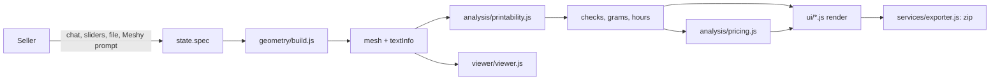

# Architecture

## How data flows



Every change follows the same loop in `public/js/app.js`:

1. Something updates `state` (a slider, the chat, a loaded project).
2. `ctx.refresh()` rebuilds the mesh, analyzes it, evaluates the checks and works out the price.
3. Every UI module's `render(ctx)` runs, and the state is saved to localStorage.

Nothing else holds model data, so panels never get out of sync.

### Key objects

- **spec**: `{ template, name, params, text }`. Fully describes a model. Always pass it through `sanitizeSpec()` (`core/spec.js`) before use.
- **mesh**: `{ pos: Float32Array, idx: Uint32Array }` in millimeters, Y up. STL export converts to Z up for slicers.
- **ctx**: the shared context every UI module receives.

| `ctx` member | What it is |
| --- | --- |
| `state` | Everything the seller chose (see `core/state.js`) |
| `current` | `{ mesh, textInfo, analysis, evaluation, price }` for the current spec |
| `imported` | Source mesh for the imported template, or `null` |
| `features` | `{ meshy, assistant, projects }` from `GET /api/health` |
| `viewer` | `setPrinter()`, `setColor()`, `showMesh()` |
| `refresh()` | Recompute and redraw from `state` |
| `setSpec(spec, { animate, resetListing })` | Replace the model |
| `save()` | Persist state to localStorage |
| `selectTab(id)` | Switch steps: `design`, `check`, `price`, `listing`, `export` |
| `colorName()`, `dimsText()`, `slug()` | Display helpers |

### Server

```
Browser ──/api/health────────▶ server/app.js
        ──/api/meshy/*────────▶ routes/meshy.js ──▶ services/meshyClient.js ──▶ Meshy
        ──/api/assistant/*────▶ routes/assistant.js ──▶ services/anthropicClient.js ──▶ Claude
        ──/api/projects/*─────▶ routes/projects.js ──▶ db/projectStore.js ──▶ data/projects.json
```

Keys are read from `.env` in `server/config.js` and never sent to the browser. Each optional route answers `503` with a clear message when its key is missing, and the page hides the matching feature.

## API reference

| Method and path | Body | Returns |
| --- | --- | --- |
| `GET /api/health` | | `{ meshy, assistant, projects }` |
| `POST /api/meshy/preview` | `{ prompt }` | `{ taskId }` |
| `GET /api/meshy/tasks/:id` | | `{ status, progress, thumbnail, error, formats }` |
| `GET /api/meshy/tasks/:id/model?format=glb` | | The model file |
| `POST /api/assistant/design` | `{ messages, spec }` | `{ reply, model }` |
| `POST /api/assistant/listing` | listing details | `{ title, description, tags }` |
| `GET /api/projects` | | `[{ id, name, createdAt, updatedAt }]` |
| `GET /api/projects/:id` | | Full project |
| `POST /api/projects` | `{ name, spec, settings, listing }` | Created project (201) |
| `PUT /api/projects/:id` | same as POST | Updated project |
| `DELETE /api/projects/:id` | | 204 |

Errors are always JSON: `{ "error": "Plain-language message" }`.

## Recipes

### Add a printer, material or marketplace

Add an entry to `PRINTERS`, `MATERIALS` or `MARKETS` in `public/js/config/catalog.js`. The dropdowns and calculations pick it up automatically.

### Add a printability check

In `evaluate()` in `public/js/analysis/printability.js`, push another `{ l: "pass" | "warn" | "fail", t: "Short title", d: "What it means and how to fix it" }`. Any measurement it needs goes in `analyze()`. Add a test in `tests/geometry.test.js`.

### Add a product template

1. Add its parameters to `TEMPLATES` in `catalog.js` (label, unit, min, max, step, default). The sliders are generated from this.
2. Write `public/js/geometry/shapes/<name>.js` that returns `{ pos, idx, minWall, info }`. The mesh must be closed (watertight).
3. Register it in `BUILDERS` in `geometry/build.js`.
4. Optional: a preset in `PRESETS`, a placement for letters in `geometry/text.js`, keywords in `localDesigner()` (`services/assistant.js`).
5. Describe it in `server/prompts/design.js` so Claude can choose it.
6. `npm test` automatically checks every preset is watertight.

### Add a UI panel or section

1. Add markup to `public/index.html` (for a new step, add a tab button and a `tabpanel`).
2. Create `public/js/ui/<name>.js` exporting `init(ctx)` for event listeners and `render(ctx)` for drawing from `ctx.current` and `ctx.state`.
3. Import it in `app.js`, call `init` in `boot()`, and add it to `PANELS`.

### Add an API route

1. Create `server/routes/<name>.js` exporting an Express `Router`. Wrap async handlers in `asyncRoute()` and throw `userError(status, message)` for problems the user should see.
2. Mount it in `server/app.js`. If it's optional, add a flag to `/api/health`.
3. Call it from a module in `public/js/services/` using `api()` from `services/api.js`.
4. Add a test in `tests/server.test.js`.

### Swap in a real database

Replace `server/db/projectStore.js` with your database code and keep the same five async functions: `list()`, `get(id)`, `create(data)`, `update(id, data)`, `remove(id)`. Nothing else has to change. Put connection settings in `.env` and `.env.example`, and keep the JSON store working for teammates who don't run the database locally.

To store imported meshes in the library, send the mesh to the server separately (they can be several MB) and keep a reference in the project.
